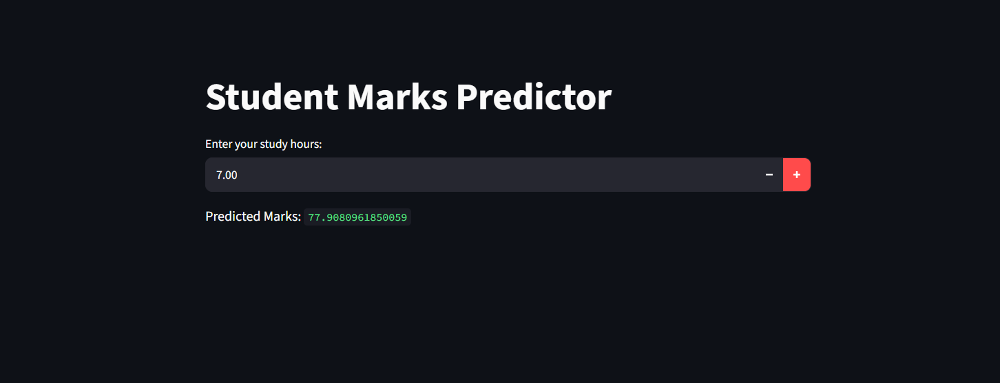

# Student Marks Predictor 

## About the Project
Student Marks Predictor is a Machine Learning project that uses Linear Regression model to predict students marks based on their study hours. The project uses Python and Streamlit to provide a simple, interactive web application.

## Technologies Used
- Python
- Pandas
- NumPy
- Matplotlib
- seaborn
- Scikit-learn
- Linear Regression
- Joblib
- Streamlit

## Features
- Predict students  marks based on study hours.
- Use a trained Linear Regression model.
- Save and load the trained model using Joblib.
- Interactive web interface using Streamlit.
- Data analysis and preprocessing using Pandas and NumPy.
- feature engineering features encoding and checking outliers using skewness

## Project Structure

students-marks-predictor/
│
├── app.py
├── linear_regression_model.pkl
├── model.ipynb
│
├── dataset/
│   ├── processed.csv
│   └── StudentMarksDataset.csv
│
├── screenshots/
│   └── streamlit-app.png
│
├── requirements.txt
├── README.md
└── .gitignore
## Project Workflow

        Student Marks Dataset
                 |
                 v
       Exploratory Data Analysis
                 |
                 v
        Data Preprocessing
                 |
                 v
         Feature Engineering
                 |
                 v
       Linear Regression Model
                 |
                 v
          Model Evaluation
             (MAE, R²)
                 |
                 v
      Save Model Using Joblib
                 |
                 v
       Streamlit Web Application
                 |
                 v
         Enter Study Hours
                 |
                 v
        Predict Student Marks

## Installation and Setup
### 1. Clone the Repository
```bash
git clone YOUR_GITHUB_REPOSITORY_URL
```


### 2. Open the Project Folder
cd students_marks_predictor


### 3. Create a Virtual Environment (Optional)
```bash
python -m venv .venv
```
```bash
.venv\Scripts\activate
```


### 4. Install Dependencies
```bash
pip install -r requirements.txt
```

### 5. Run the Application
```bash
streamlit run app.py
```

The application will open in your browser, usually at `http://localhost:8501`.

## How to Use
1. Open the web application.
2. Enter your study hours.
3. View the predicted marks.

## streamlit web page



## Model Evaluation
The Linear Regression model can be evaluated using:
- Mean Absolute Error (MAE): Measures the average absolute difference between actual and predicted marks.
- R² Score: Measures how well the model explains variation in the target values.

Actual evaluation results should be added after testing the model.

## Future Improvements
- Connect the application to a MySQL database.
- Improve feature engineering and preprocessing.
- Improve the user interface.

## Author
Ishika Raghav 

Created as a beginner Machine Learning project to learn data preprocessing,feature enginering, Linear Regression, model evaluation, and Streamlit application development.
